

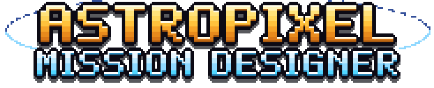

### Design a real space mission. Fly it. Find out if your engineering holds up.

A pixel-art space mission game built on real NASA numbers, for 1 to 4 players.
 Team **Shay Rafe3**, NASA Space Apps Challenge 2026: *Space Mission Design Game*.

 

&nbsp;

  

  

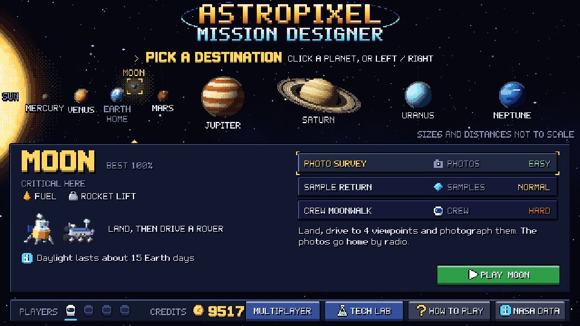

---

## The idea

Real missions succeed or fail long before launch: in the mass budget, the power budget and the margins
an engineer was brave enough to keep. **AstroPixel** puts you in that seat. Pick a destination
anywhere in the Solar System, build a spacecraft that can survive it, then fly every phase yourself.
When something goes wrong, the game tells you the real physics behind it, and which real mission it
happened to.

| 🪐 **8 destinations** | 🛠️ **Real engineering** | 🎲 **Real surprises** | 👩‍🚀 **Play as a team** |
|---|---|---|---|
| The Moon, Mercury, Venus and Mars to land on. Jupiter, Saturn, Uranus and Neptune to sample from orbit. 3 tasks each, from EASY to HARD. | Gravity, sunlight, distance, rocket lift and prices come from NASA and the makers. Margins follow JPL's early-design checklist. | 37 decision events taken from real missions: solar storms from NASA DONKI, Apollo 13's tank, Spirit's stuck wheel and more. | 4 roles: Planner, Engineer, Scientist, Comms. Each owns part of the ship and a job in flight. |

## How a mission goes

<table>
<tr>
<td width="50%">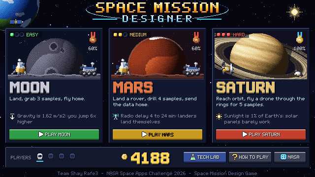</td>
<td width="50%">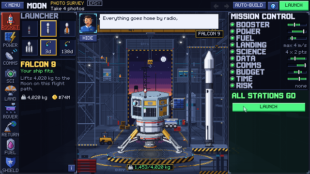</td>
</tr>
<tr>
<td><b>1 · Pick a destination and a task.</b> The menu shows what's critical there (power, fuel, rocket lift…) and what will end the mission.</td>
<td><b>2 · Build the spacecraft.</b> Drop parts onto the ship in the hangar. Every part is tagged REQUIRED, RECOMMENDED, OPTIONAL or NOT NEEDED HERE. Mission Control lights one lamp per system.</td>
</tr>
<tr>
<td>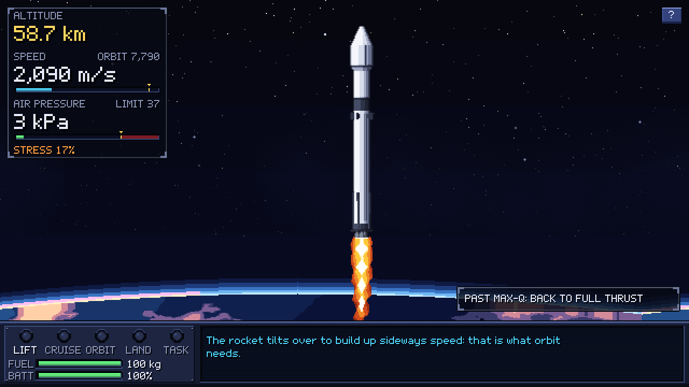</td>
<td>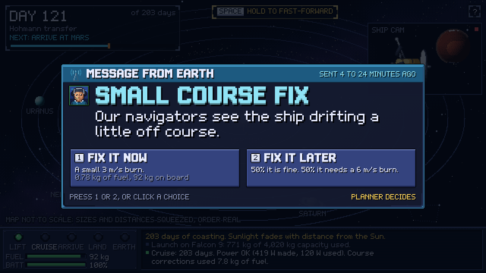</td>
</tr>
<tr>
<td><b>3 · Fly the launch.</b> Throttle back through max-Q, drop the boosters, release the fairing and deploy your spacecraft.</td>
<td><b>4 · Make the calls.</b> On the way out, at the target and on the way home, events force a decision. The odds and the price are shown before you choose.</td>
</tr>
<tr>
<td>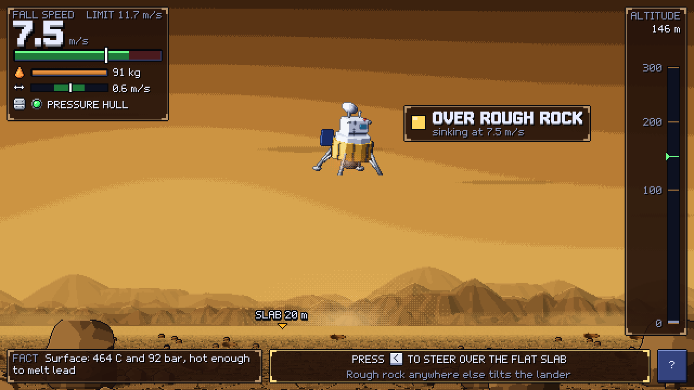</td>
<td>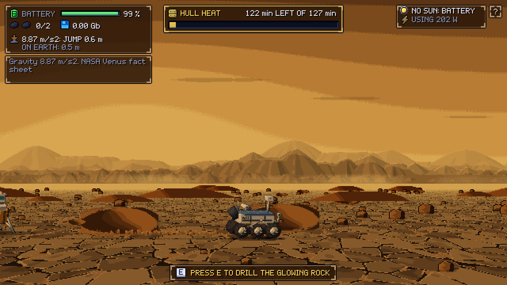</td>
</tr>
<tr>
<td><b>5 · Land.</b> Real gravity and fuel burned by real mass flow. On Venus the thick air brakes for you, but only a pressure hull survives.</td>
<td><b>6 · Explore.</b> Drive the rover and drill samples before the night, the heat or the battery ends the day. Venus gives you 127 minutes, like Venera 13.</td>
</tr>
<tr>
<td>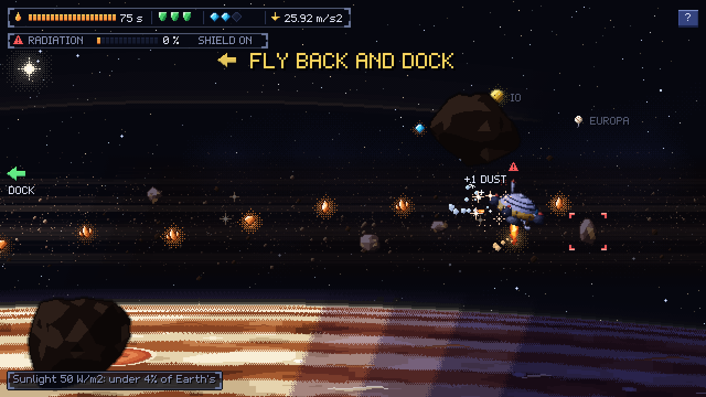</td>
<td>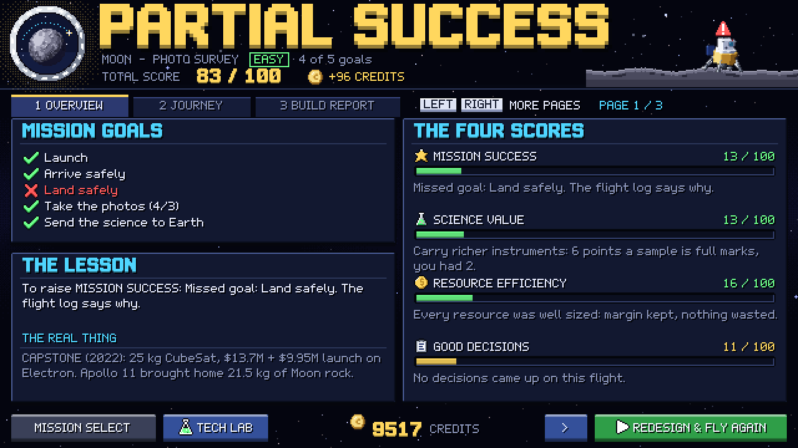</td>
</tr>
<tr>
<td><b>5b · Or dive into the rings.</b> At the giant planets a drone leaves the orbiter, grabs ice and dust, dodges rocks and docks back. Inspired by Cassini's Grand Finale.</td>
<td><b>7 · Read the report.</b> Four scores (mission success, science, resource efficiency, decisions), a build report that rates every resource as under-used, well used or over-used, and a letter grade.</td>
</tr>
</table>

## Play it

| Where | How |
|---|---|
| 🌐 **Browser** | **[Play here](https://omarshobaki-png.github.io/Shay-Rafe3-Nasa-Space-App-Challenge/play/)**: no download, no login. Works in Chrome, Edge and Firefox. The [project website](https://omarshobaki-png.github.io/Shay-Rafe3-Nasa-Space-App-Challenge/) explains the challenge, our solution and the NASA data. |
| 🪟 **Windows** | A downloadable build is coming soon on the [Releases](https://github.com/omarshobaki-png/Shay-Rafe3-Nasa-Space-App-Challenge/releases) page. |
| 🧑‍💻 **From source** | Install [Godot 4.7.2](https://godotengine.org/download), open `game/project.godot` and press **F5**. On Windows, double-click `Play Game.bat`. |
| 💻 **Web build locally** | Serve the `docs/` folder, for example `python -m http.server 8000 --directory docs`, then open http://localhost:8000/play/. Opening `index.html` by double-click fails ("Failed to fetch"). |

**Controls:** the mouse for menus and the builder. In flight, every screen shows one direction at a time
with the key to press (for example **W/S** throttle and **SPACE** to stage at launch, **arrows** to fly
and drive, **E** to drill). Press **?** at any time for the full list.

**Multiplayer (1–4):** choose MULTIPLAYER on the menu, then HOST to get a 4-letter room code or JOIN
with one. It runs through a small relay server ([`server/`](server/README.md)).

## Built on real data

| Real (NASA and makers) | Game rules (marked in the code) |
|---|---|
| Gravity, sunlight, distances, radio delays ([NASA planetary fact sheets](https://nssdc.gsfc.nasa.gov/planetary/factsheet/)) | Some part prices |
| Rocket capacities and prices (Falcon 9, Falcon Heavy, Vulcan, Electron) | Landing-leg limits |
| Margins: 35% mass, power and energy (JPL Concept Maturity Level 4); 25% budget reserve (NASA Discovery 2019) | 8 hours of Deep Space Network contact a day |
| MMRTG 110 W / 45 kg, Li-ion Wh/kg, solar array W/kg | $10M a year of operations |
| MRO and LRO data rates; CTX, CRISM and Cassini MAG specs | Drone fuel; development days per part type |
| Real solar storms from [NASA DONKI](https://kauai.ccmc.gsfc.nasa.gov/DONKI/) | Multiplayer job details (waiting for team approval) |
| Apollo, CAPSTONE, Perseverance, Cassini, Venera, MESSENGER and Juno facts | |

Every number lives in [`game/scripts/data.gd`](game/scripts/data.gd) with a `src` field that names its
source, or says "game rule" or "game estimate". The in-game **NASA DATA** screen lists them all.

## Gallery

<table>
<tr>
<td>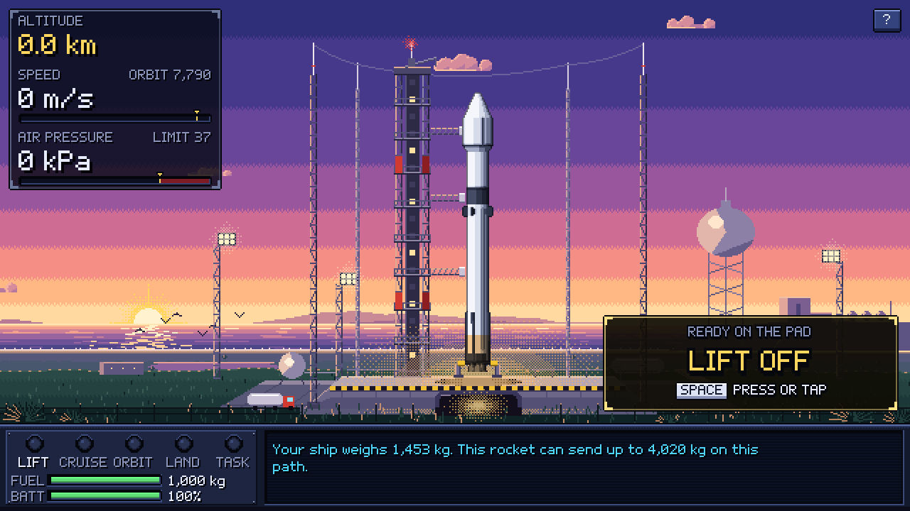</td>
<td>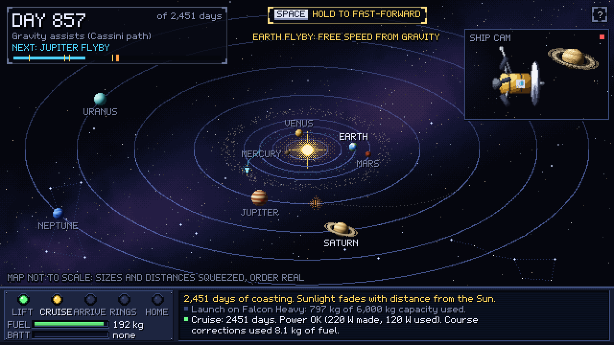</td>
<td>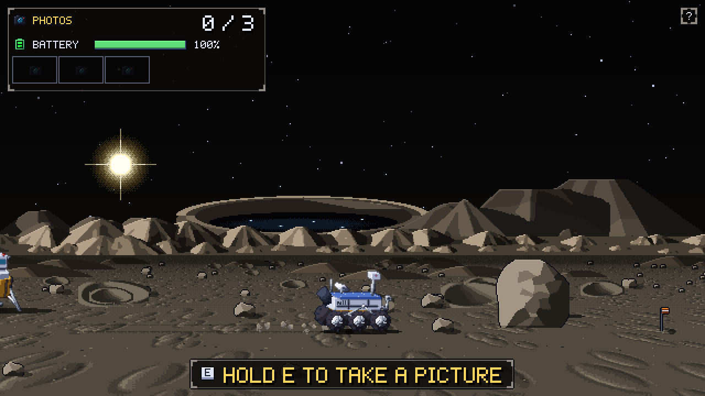</td>
</tr>
<tr>
<td align="center">T-3 on the pad</td>
<td align="center">Cruise to Saturn with gravity assists</td>
<td align="center">Driving on Mercury</td>
</tr>
<tr>
<td>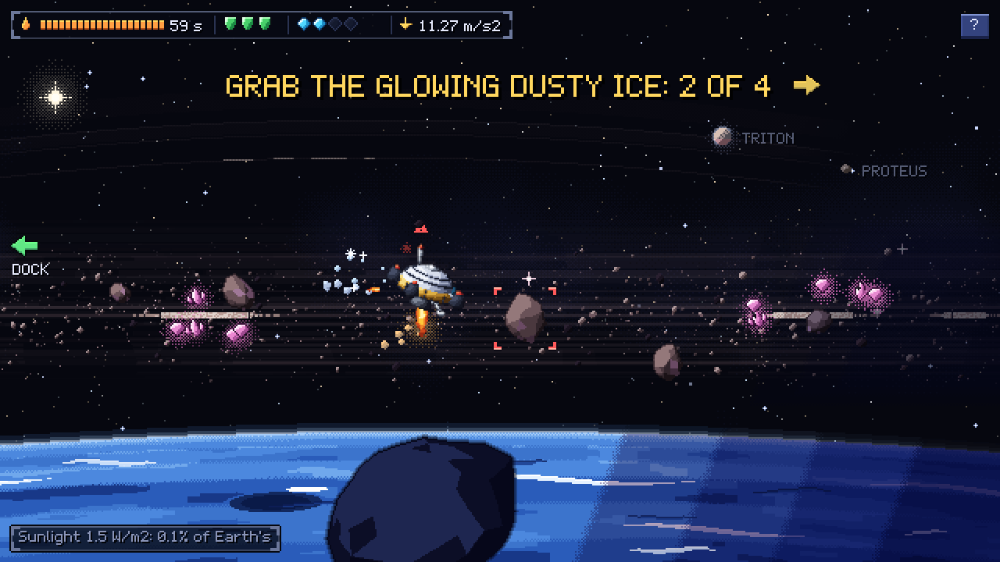</td>
<td></td>
<td></td>
</tr>
<tr>
<td align="center">Sampling Neptune's rings</td>
<td align="center">Steering onto a flat slab on Venus</td>
<td align="center">The hangar and Mission Control</td>
</tr>
</table>

## Repository

| Folder | What's inside |
|---|---|
| [`game/`](game/) | The Godot 4.7.2 project (GDScript). [`game/tools/`](game/tools/) holds the scripts that generate every sprite, background and sound. |
| [`docs/`](docs/) | The GitHub Pages site: the project website (`index.html`) and the game's web build (`play/`). |
| [`server/`](server/) | The multiplayer relay (Node.js, WebSockets) and its tests. |
| [`context/`](context/README.md) | The team's notes, project brief, status and roadmap, game design and decisions, and the NASA resources guide. **Start here if you're joining the project.** |
| [`research/`](research/) | Our study of the challenge, the real numbers and their sources. |
| [`screenshots/`](screenshots/) | Screenshots of the current version (`v4/` holds older ones). |

<b>Code map</b> (all paths inside <code>game/</code>)

- `scripts/data.gd`: every number and its source.
- `scripts/game.gd`: ship maths, simulation, margins, scoring, save, multiplayer state.
- `scripts/events.gd`, `scripts/event_card.gd`: the 37 decision events and their pop-up.
- `scripts/preflight.gd`: GO / NO-GO rules, part needs and the builder checklist.
- `scripts/net.gd`: the network layer. `scripts/team_ui.gd`: shared multiplayer UI.
- `scripts/screens/*.gd`: menu, builder, launch, flight, landing, surface, probe (ring drone), report.
- `scripts/ship_kit.gd`, `scripts/vab_meta.gd`: assemble the ship from part sprites.
- `scripts/pix.gd`, `scripts/ui.gd`, `scripts/fx.gd`, `scripts/audio.gd`: art, UI kit, effects, sound.
- `tools/dev/balance.gd`: checks that every task has a working all-green ship.

Debug: run with `-- screen=builder dest=mars` (also `launch`, `flight`, `landing`, `surface`, `probe`,
`report`; any of the 8 destinations) to open a screen directly with the example ship.

## AI disclosure

- **The game idea and design are the team's.** Every design decision is recorded in
  [`context/03_GAME_DESIGN.md`](context/03_GAME_DESIGN.md).
- **Code:** Claude (Anthropic) wrote most of the GDScript code and the asset-generation scripts. OpenAI
  Codex wrote part of the multiplayer port to v5, and Claude reviewed and finished it. The team
  reviewed and tested the code.
- **Art:** no AI image or video generator was used. Every picture is made by code you can re-run:
  - spacecraft, parts and launch vehicles: simple 3D models built by Python scripts in Blender,
    rendered and turned into palette pixel art (`tools/blender/`, `tools/art/gen_*.py`);
  - planets, backgrounds, ground, rocks and clouds: numpy noise and dithering (`tools/art/`).
- **Sound:** all 67 sound files (effects, ambience and 5 music tracks) are synthesized with numpy
  (`tools/audio/`). No recordings, no samples.
- **Font:** the pixel font comes from our earlier game, Rotorfall.
- **Screenshots** in this README are captured from the game itself.
- **Research write-ups:** Claude compiled the NASA data sheet
  (`context/reference/NASA_Data_In_Game.pdf`, from the team's research notes and the sources in
  `data.gd`) and wrote the project website (`docs/index.html`). The team reviews them.
- **Multiplayer:** the scope is the team's (decision D7). Where it left gaps, the AI proposed small
  mechanics (a landing-site choice, the Scientist's parachute and legs job, a drone throttle, the Comms
  downlink pick, who decides each event, the team sync weights). They are marked "game rule" in
  `data.gd` and are waiting for the team to approve or change them.
- **No NASA logos are used.**

 
Made for the NASA Space Apps Challenge 2026 by Team Shay Rafe3. Not affiliated with or endorsed by NASA.

