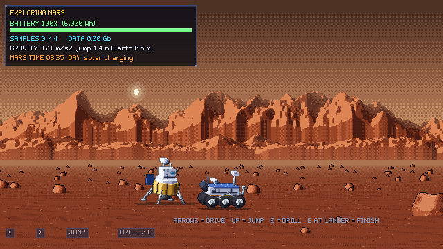

# Space Mission Designer

Team Shay Rafe3, NASA Space Apps Challenge 2026, challenge "Space Mission Design Game".

> **New to the project? Read [`context/README.md`](context/README.md) first** (about 15 min). It covers
> what we're building, the current state (v3), the to-do list, open team decisions and every NASA
> resource we use. Using Claude Code? It reads [`CLAUDE.md`](CLAUDE.md) automatically.

## Play it

- **In a browser:** the web build is in `docs/`. Turn on GitHub Pages for this repository
  (Settings > Pages > Deploy from a branch > `main`, folder `/docs`) and the game runs at
  `https://<your-user>.github.io/<this-repo>/`. No download and no login.
- **On Windows:** download `SpaceMissionDesigner-windows.zip` from this repository's Releases, unzip it and
  run `SpaceMissionDesigner.exe` (keep the `.pck` file next to it).
- **From source:** open `game/project.godot` in Godot 4.7.2 and press F5.

## What is in this repository

- `game/`: the Godot 4.7 project (GDScript). `game/tools/` holds the scripts that generate every sprite,
  background and sound.
- `docs/`: the exported web build (what GitHub Pages serves).
- `context/`: the team's merged notes (the vision), the project brief, status and roadmap, game design
  and decisions, the NASA resources guide, and the build history.
- `CLAUDE.md`: working rules for AI assistants and teammates.
- `builds/` (not in git): put the Windows zip here locally; publish it as a GitHub Release.
- `screenshots/`: pictures of every screen.
- `research/`: our study of the challenge, the real numbers and their sources.

## How a mission goes

1. **Menu.** Pick the Moon (easy), Mars (medium) or Saturn (hard), and 1 to 4 players.
2. **Builder.** There are four role tabs; with several players, each player takes one:
   - **Planner:** rocket, flight path, budget, time.
   - **Engineer:** mass, power, fuel.
   - **Scientist:** instruments, rover, drone, return stage.
   - **Comms:** antenna, storage, downlink.

   Seven bars turn green, yellow or red. Hover any bar or part to see the formula and the NASA source. **EXAMPLE SHIP** loads a ship that works.
3. **Review board.** It gives GO or NO-GO per resource. You can still launch a NO-GO ship to see what breaks.
4. **Flight.** Launch, cruise map, orbit arrival:
   - Power falls with distance from the Sun squared.
   - Fuel follows the rocket equation (Isp 300 s).
   - A real 2024 geomagnetic storm from NASA DONKI hits the ship.
5. **Landing (Moon, Mars).**
   - Controls: UP/W/SPACE fires the engine, LEFT/RIGHT steers.
   - Gravity is the real value, and fuel burns by real mass flow.
6. **Surface.**
   - Controls: arrows to drive, UP to jump, E to drill a rock, E at the lander to finish.
   - Jump height follows real gravity: 3.2 m on the Moon, 1.4 m on Mars.
   - On Mars, night lasts about 12 hours and the rover runs on its battery.
7. **Saturn drone.** Fly from the orbiter into the rings, grab ice grains, dodge rocks and dock back. It is inspired by Cassini's Grand Finale.
8. **Report.**
   - Goals met or missed, with the cause chain ("why") and a tip.
   - A score per role, and a comparison with a real mission.
   - Credits earned. Credits buy tech in the Tech Lab.

## What is real and what is a game rule

- **Real (from NASA and makers):**
  - Gravity, sunlight and distances.
  - Radio delays.
  - Rocket capacities and prices.
  - MMRTG 110 W / 45 kg.
  - Li-ion Wh/kg and solar array W/kg.
  - MRO and LRO data rates.
  - CTX, CRISM and Cassini MAG specs.
  - Delta-v values.
  - Apollo, CAPSTONE, Perseverance and Cassini facts.
  - DONKI storms.
- **Game rules** are marked "game rule" or "game estimate" in `scripts/data.gd`:
  - Part prices for some parts.
  - Landing leg limits.
  - 8 h of DSN contact a day.
  - $10M per year operations.
  - Drone fuel.
- Every number's source is in `scripts/data.gd` (`src` fields) and on the in-game "NASA DATA & CREDITS" screen.

## AI disclosure (for the submission form)

- The game idea and design are the team's.
- Claude (AI) wrote the GDScript code and the scripts that make the art and sound, and the team reviewed it:
  - Spacecraft sprites (rocket, lander, rover, drone, orbiter): simple 3D models built by a Python script in Blender, rendered and turned into palette pixel art (`tools/blender/ships.py`, `tools/art/gen_ships.py`).
  - Planets, backgrounds, ground, rocks and clouds: generated with numpy noise and dithering (`tools/art/gen_bg.py`).
  - Sound effects and the two music loops: synthesized by code (`tools/audio/`, the Godot skill's sfx/music generators).
  - The pixel font comes from our earlier game, Rotorfall.
- No NASA logos are used.
- No AI image or video generators were used: every picture is made by code you can re-run.

## Files

- `scripts/data.gd`: all numbers and sources.
- `scripts/donki_data.gd`: real NASA DONKI storm snapshot.
- `scripts/game.gd`: ship maths, simulation, money, save.
- `scripts/screens/*.gd`: menu, builder, flight, landing, surface, probe, report.
- `scripts/pix.gd`: loads the art, draws pixel text, HUD panels and parallax layers.
- `scripts/audio.gd`: sound effects, engine loops and music.
- `art/`, `audio/`: generated assets. Re-make them with `tools/` (Blender 4+/5, Python with numpy and Pillow).

All paths in the list above are inside `game/`.

Debug: `SpaceMissionDesigner.exe -- screen=builder dest=mars` opens a screen directly, with the example ship.
